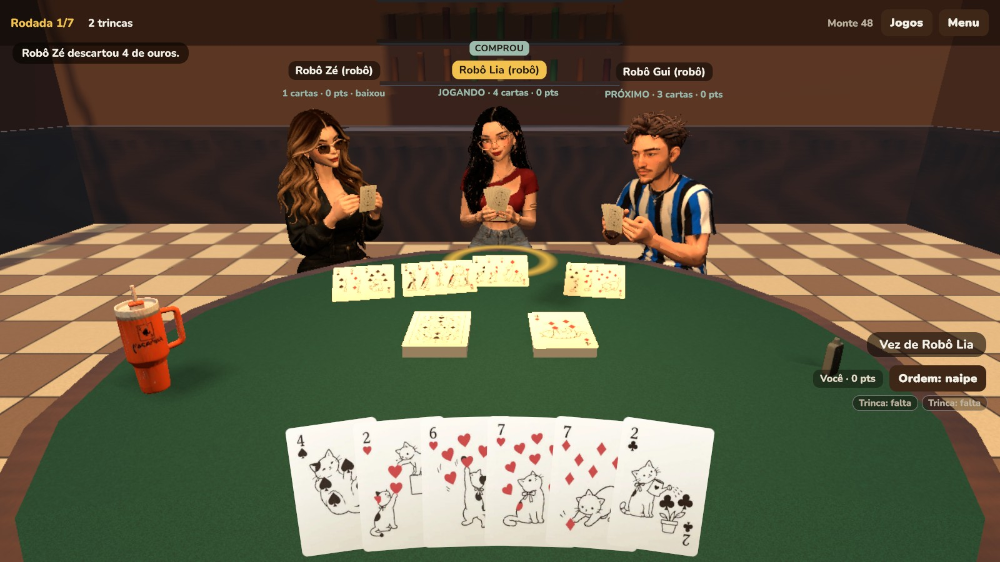
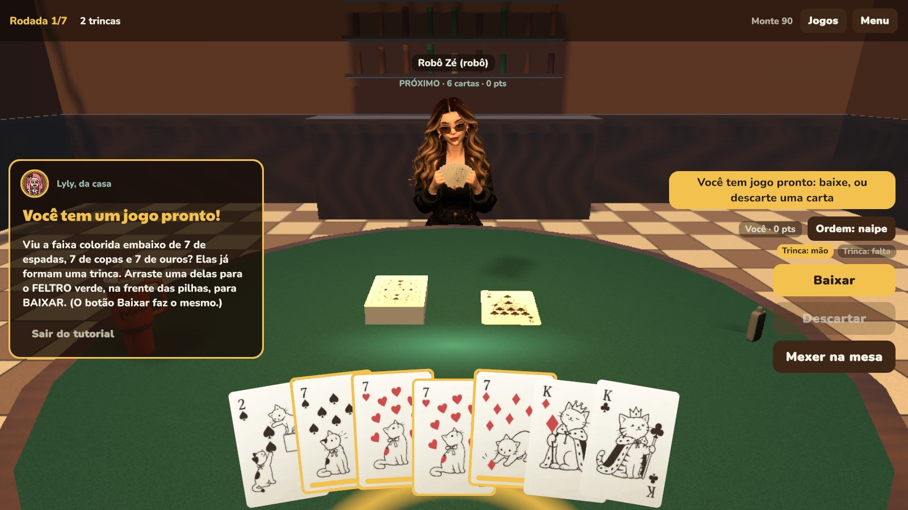
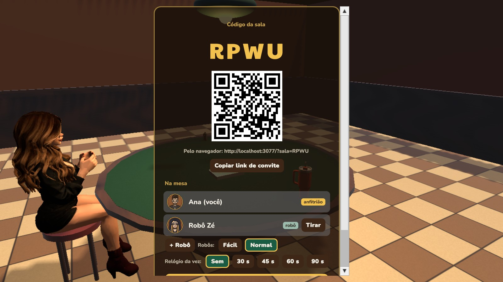
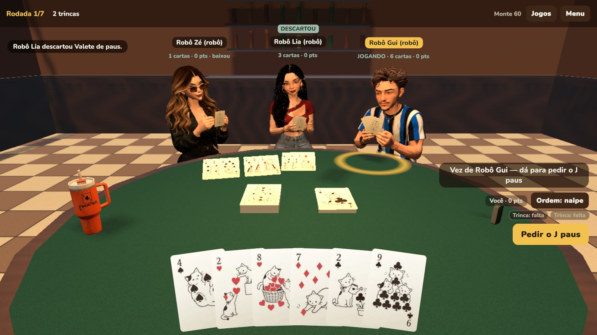
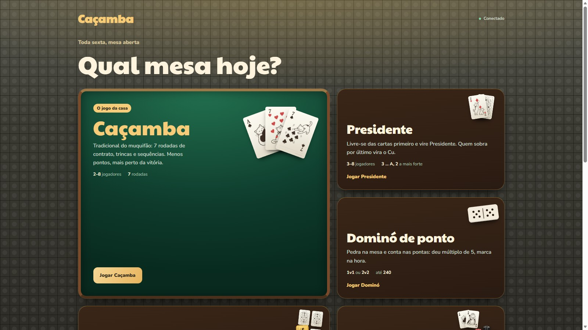
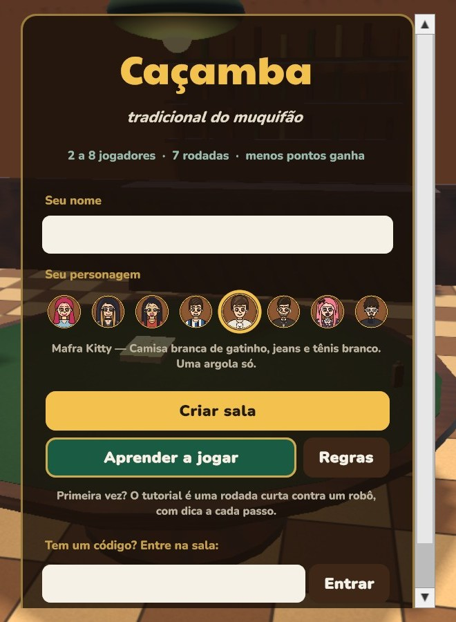
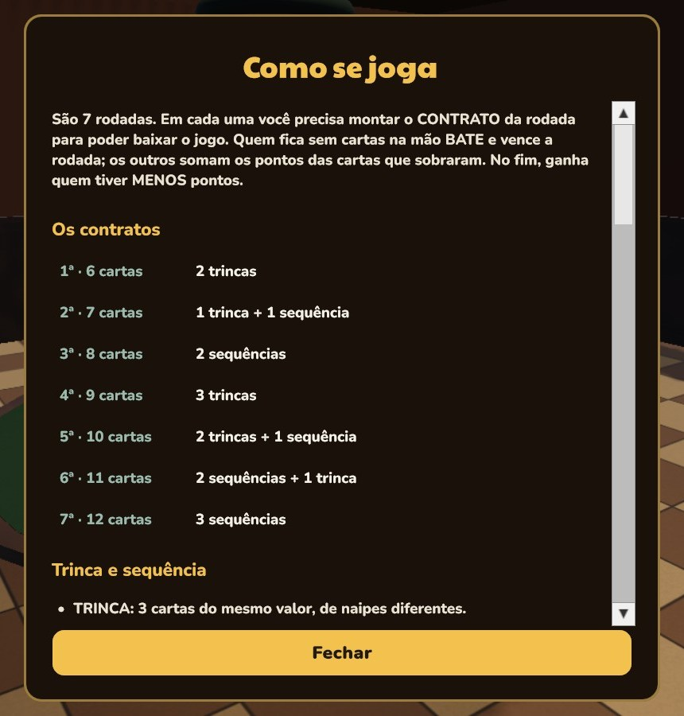

# 🃏 Caçamba

**Tradicional do muquifão.** O Caçamba é um jogo de cartas multiplayer de 2 a 8
jogadores, cada um no seu aparelho. São **7 rodadas de contratos** — trincas e
sequências — e ganha quem terminar com **menos pontos**.

Dá para jogar de dois jeitos, na mesma sala:

- **no navegador**, sem instalar nada, no celular ou no computador;
- **no app em Unity**, com a mesa 3D do boteco e os oito personagens do elenco
  (Windows, navegador, Android e iOS).

<p align="center">
  
</p>
<p align="center"><sub>Uma partida no app: robôs à mesa, jogos baixados no feltro, o monte e o meio no centro e a sua mão embaixo.</sub></p>

## O que tem

- **Sala com código:** alguém cria a sala e os outros entram pelo código de 4
  letras ou pelo QR, como no Kahoot. No celular, o site pode ser fixado na tela
  inicial como aplicativo (PWA).
- **Robôs** para completar a mesa quando falta gente.
- **Tutorial com a Lyly:** uma rodada guiada que ensina o jogo em duas vezes.
- **Relógio da vez**, opcional, de 30 a 90 segundos.
- **Pedido fora da vez:** quando alguém descarta, os outros podem pedir a carta.
- **App em Unity** com animações, sons gerados no próprio app e vibração no
  celular.
- **Servidor juiz:** as regras moram no servidor, e é ele quem decide cada
  jogada.
- **Mais sete jogos no site:** Presidente, Dominó, Bazuca, Poker, Mexe-Mexe,
  Canastra e Puxadinho.

## Imagens

| | |
|:---:|:---:|
|  |  |
| **Tutorial:** a Lyly mostra que os três 7 já formam uma trinca e ensina a baixar. | **Sala de espera:** código de 4 letras, QR e link de convite, robôs e o relógio da vez. |
|  |  |
| **Fora da vez:** o Robô Lia descartou o Valete de paus e, mesmo na vez de outro, aparece o botão para pedir a carta. | **O site:** a escolha da mesa entre os jogos da plataforma. |

<p align="center">
  
  &nbsp;
  
</p>
<p align="center"><sub>A tela inicial do app e o “Como se joga”, aberto pelo botão Regras.</sub></p>

## Como se joga

Cada rodada tem um **contrato** para cumprir, e ganha uma carta a mais que a
anterior:

| Rodada | Cartas | Contrato |
|---|---|---|
| 1ª | 6 | 2 trincas |
| 2ª | 7 | 1 trinca + 1 sequência |
| 3ª | 8 | 2 sequências |
| 4ª | 9 | 3 trincas |
| 5ª | 10 | 2 trincas + 1 sequência |
| 6ª | 11 | 2 sequências + 1 trinca |
| 7ª | 12 | 3 sequências |

- **Trinca:** 3 cartas do mesmo valor, com naipes diferentes.
- **Sequência:** 4 cartas seguidas do mesmo naipe (o Ás vale 1 ou 14, mas não
  vira a esquina).

Na sua vez você **puxa uma carta** (do monte ou do meio) e **descarta uma** — as
duas coisas são obrigatórias. Entre elas, dá para **baixar seus jogos**, um de
cada vez, e **encaixar** cartas nos jogos da mesa depois que o contrato inteiro
estiver baixado.

Quando alguém descarta, os outros podem **pedir a carta**: leva quem apertar
primeiro — a não ser que quem está na vez também a queira, porque ele tem
preferência.

O **coringa** só vale em sequência (no máximo um por sequência), custa 20 pontos
se sobrar na sua mão e **trava o meio** enquanto estiver descartado por cima.
Quem tiver a carta exata que ele representa pode trocá-la por ele.

As regras completas estão dentro do jogo: no botão **?** do site e no botão
**Regras** do app.

## Como rodar na sua máquina

### 1. Instale o que precisa

- **[Node.js](https://nodejs.org) 20 ou mais novo.** O npm vem junto.
- **[Git](https://git-scm.com)**, para baixar o projeto. Sem Git, use
  **Code → Download ZIP** nesta página e descompacte.
- Opcional, para o app 3D: **[Unity Hub](https://unity.com/download)** com o
  **Unity 6 (`6000.0.41f1`)**.

### 2. Baixe o projeto

```bash
git clone https://github.com/Hendrick01/projeto-cacamba.git
cd projeto-cacamba
```

### 3. Instale as dependências

```bash
npm install
```

> **Windows (PowerShell):** se aparecer *"a execução de scripts foi desabilitada
> neste sistema"*, use `npm.cmd` no lugar de `npm` — por exemplo,
> `npm.cmd install` e `npm.cmd start`.

### 4. Ligue o servidor

```bash
npm start
```

O terminal mostra dois endereços: um para este computador
(`http://localhost:3000`) e outro para os celulares na mesma rede Wi-Fi. O
servidor fica no ar enquanto o terminal estiver aberto; para desligar, aperte
`Ctrl+C`.

### 5. Jogue

1. Abra **http://localhost:3000** no navegador.
2. Escolha o **Caçamba**, digite seu nome, escolha um personagem e clique em
   **Criar minha sala**.
3. Chame mais gente ou clique em **Adicionar robô**. Num celular da mesma rede
   Wi-Fi, abra o endereço para celulares que o terminal mostrou e entre com o
   código de 4 letras, ou aponte a câmera para o QR da sala.
4. Clique em **Começar partida**.

### 6. Opcional: o app em Unity

1. No Unity Hub, clique em **Add → Add project from disk** e escolha a pasta
   **`unity/`** deste projeto. A primeira abertura demora, porque o Unity
   importa tudo.
2. Abra a cena `Assets/Cacamba/Cenas/Cacamba.unity` e aperte **Play**.
3. Por padrão, o app liga no servidor publicado. Para jogar com o seu, deixe o
   `npm start` rodando e troque o campo **Servidor** da tela inicial para
   `http://localhost:3000`.

As builds (Windows, navegador, Android e iOS) e o cuidado com acento no caminho,
que o Android não aceita, estão em [`unity/LEIA-ME.md`](unity/LEIA-ME.md). A
build de navegador não vem no repositório, porque tem dezenas de MB: depois de
gerada pelo Unity, o servidor a serve em `http://localhost:3000/unity/`.

### Testes

```bash
npm test                   # a suíte completa: regras, servidor, modelos e voz
npm run test:security      # segurança HTTP e WebSocket
npm run test:integration   # sobe e derruba um servidor local sozinho
```

Os testes `node test/e2e.mjs` e `node test/sair.mjs` pedem o servidor no ar. Os
scripts Python em `scripts/` são ferramentas opcionais de preparação e
conferência dos modelos (NumPy e SciPy); o jogo não depende de Python.

## Publicar na web

O jogo guarda as salas em memória e conversa por WebSocket, então precisa de um
servidor rodando o tempo todo. **Não funciona** em Vercel, Netlify ou Cloudflare
Pages, que são serverless. Servem Render, Fly.io, Railway e Koyeb.

Para o Render, o [`render.yaml`](render.yaml) já está pronto: no painel, escolha
**New → Blueprint** e aponte para este repositório. Ele cria o serviço sozinho.

Variáveis de ambiente que o servidor entende:

| Variável | Para que serve |
|---|---|
| `PORT` | Porta. As hospedagens injetam sozinhas. |
| `HOST` | Interface de escuta (padrão `0.0.0.0`). |
| `PUBLIC_URL` | Endereço fixo do site, usado no link de convite e no QR. |
| `TRUST_PROXY` | `1` atrás de proxy reverso, para o convite sair com o endereço público. |
| `ALLOWED_HOSTS` | Lista de hosts aceitos no convite, separados por vírgula. |
| `DATABASE_URL` | Banco Postgres das contas e da loja. Sem ele, o jogo funciona igual. |

Sem `PUBLIC_URL`, o endereço do convite sai dos cabeçalhos da requisição (com
`TRUST_PROXY=1`) e, em último caso, do IP da rede local. Com `PUBLIC_URL`
definido, conexões WebSocket precisam enviar o `Origin` exato do site, como os
navegadores fazem; ferramentas de teste externas também precisam configurá-lo.
Use `TRUST_PROXY=1` somente quando a origem estiver atrás de um proxy confiável
que trate `X-Forwarded-For` corretamente.

As contas, a loja, o e-mail e a voz têm variáveis próprias (`SEGREDO_SESSAO`,
`KIWIFY_TOKEN`, `RESEND_API_KEY`, `PIX_*`, `TURN_*`). Nenhuma delas é necessária
para jogar.

## Por dentro

Node.js puro em ESM, sem framework e sem build. São três dependências: `ws`
(WebSocket), `qrcode` (o QR da sala) e `postgres` (contas e loja). O servidor é
o **juiz** — nenhuma regra é confiada ao navegador nem ao app. O motor de regras
do Caçamba vive em [`shared/engine.js`](shared/engine.js) e roda nos dois lados:
no servidor decidindo, no site apenas para a tela não oferecer um gesto que o
juiz recusaria. O app em Unity é mais um cliente do mesmo servidor, e por isso
app e navegador entram na mesma sala.

| Caminho | O que tem |
|---|---|
| [`server.js`](server.js) | O servidor: salas, WebSocket, robôs e relógio da vez |
| [`shared/`](shared) | Os motores de regras de cada jogo (o do Caçamba é o `engine.js`) e o roteiro do tutorial |
| [`public/`](public) | O site: telas, mesas 2D e 3D, personagens, cartas e modelos |
| [`lib/`](lib) | Segurança, selo da sala, contas, loja, Pix e e-mail |
| [`unity/`](unity) | O app em Unity |
| [`test/`](test) | Os testes |
| [`scripts/`](scripts) | Ferramentas de preparação: modelos 3D, mãos, arte para o Unity e o teste de interface no navegador |
| [`docs/`](docs) | A documentação técnica e as imagens deste README |

### Tutorial

O "Aprender a jogar" do app manda `create` com `tutorial: true`, e o servidor:

- já põe um robô e começa a partida;
- não deixa ninguém de fora entrar;
- arruma a primeira rodada pelo roteiro de
  [`shared/tutorial.js`](shared/tutorial.js), com dois baralhos e o robô
  normal, que não sorteia jogada.

O roteiro faz aparecer, em duas vezes: puxar, baixar, encaixar, descartar,
pegar do meio e bater. Quem garante que o robô de verdade segue o roteiro é
o `test/tutorial.test.js` (no `npm test`). O mesmo caminho pelo fio é provado
pelo `npm run test:tutorial`, com o servidor no ar
(`RITMO_DOS_ROBOS=0.05 node server.js`).

### Relógio da vez

Opcional: a sala nasce sem relógio, e quem criou a sala escolhe no lobby — 30,
45, 60 ou 90 segundos por vez (no app e no site). Com relógio, quem estoura o
prazo tem a vez jogada no mínimo: o jogo puxa do monte e descarta (a carta
puxada, ou a que menos serve), sem baixar nem encaixar nada — e na vez seguinte
o relógio volta inteiro. Robô não tem relógio. A prova é
`npm run test:relogio`, com o servidor no ar e o prazo encurtado
(`CACAMBA_VEZ_MS=1500 RITMO_DOS_ROBOS=0.05 node server.js`).

## Documentação

- [`docs/Documentacao-Tecnica-Cacamba.docx`](docs/Documentacao-Tecnica-Cacamba.docx):
  a documentação técnica — regras, arquitetura, protocolo, servidor, site, app
  em Unity, testes, dificuldades, limitações e evolução futura.
- [`unity/LEIA-ME.md`](unity/LEIA-ME.md): o app em Unity — abrir, jogar e gerar
  as builds.
- [`ESTRUTURA.md`](ESTRUTURA.md): o projeto arquivo por arquivo.
- `REVISAO-*.md`: os relatórios de revisão de setembro de 2026. O de
  [06/09](REVISAO-2026-09-06.md) cobre a articulação dos dedos dos oito modelos
  (com controle de flexão em `provador.html`), o visual e a segurança.
